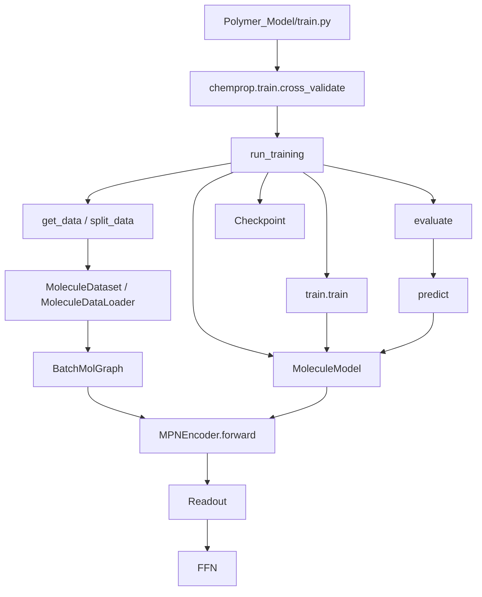
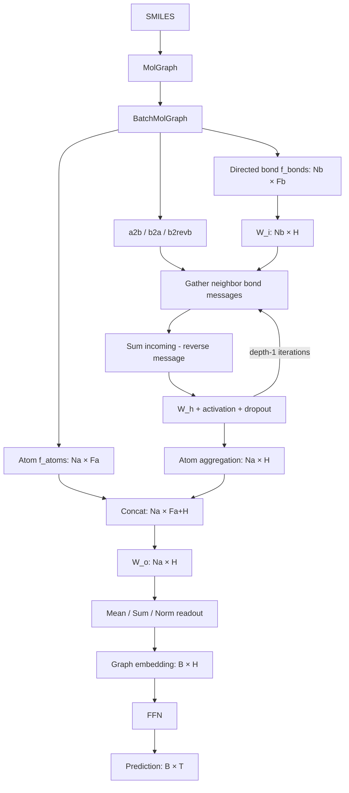
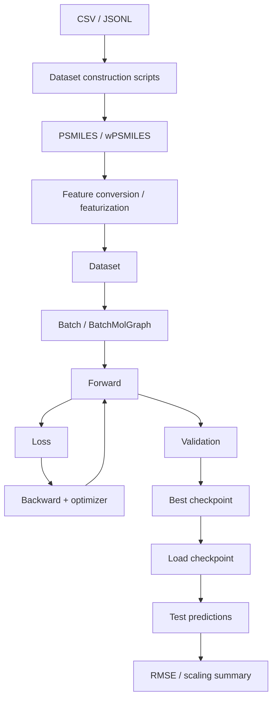
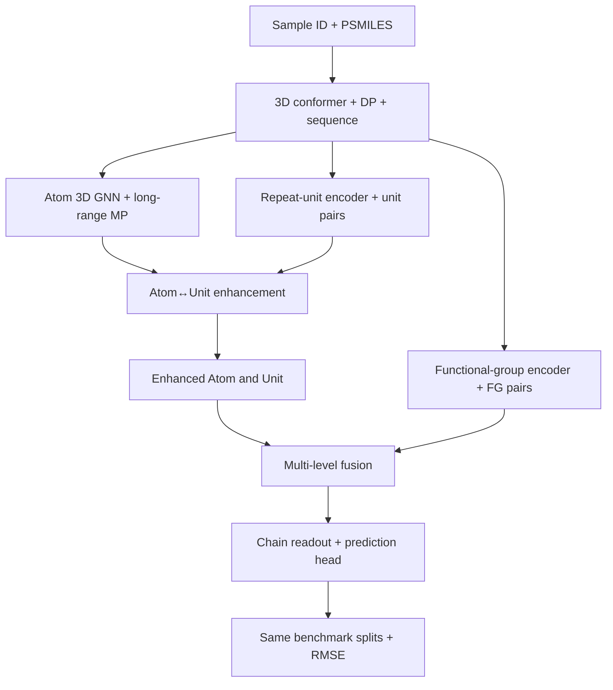

# PolymerBenchmark2026 — 四大架构图

> 基于上传的 PolymerBenchmark2026-main.zip 静态源码。实线表示经源码文件/函数定位的计算路径；示意节点不等于动态 profiler 调用栈。外部 Chemprop 代码不在 ZIP 内。

## 1. 源码模块及关键函数调用图

## 2. GNN 张量形状及消息传递图

*符号：Na/Nb 是含 padding 的批图原子/有向键数；Fa/Fb 为运行时特征维度；H=hidden_size；B=batch 图数量；T=num_tasks。若启用 atom_messages 或额外 descriptors，路径和维度会发生变化。*

## 3. 数据处理—训练—预测全流程

## 4. 与3D多层级聚合物表征的接口映射（建议方案，非仓库现有实现）

详尽的72个Python文件、468个函数/类/方法及源码行号和静态调用索引，见配套Word/PDF文档。
